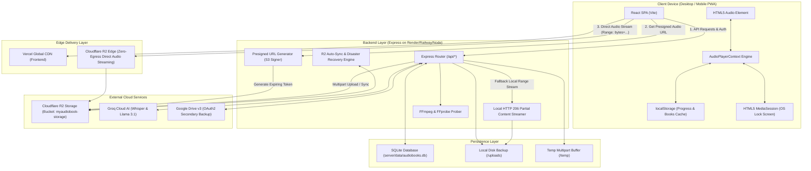
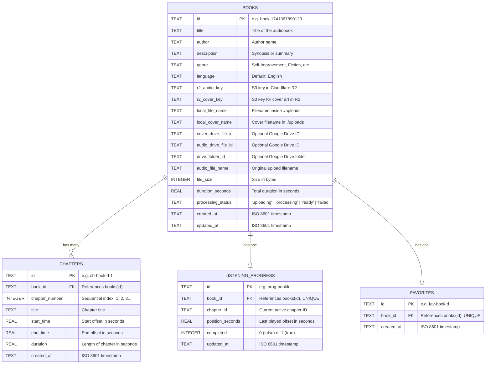

# 🎧 MyAudioBook — Complete Technical Specification & Project Documentation

> **Version:** 2.0.0  
> **Target Audience:** Developers, DevOps Engineers, Architects, and System Administrators  
> **Repository:** `MyAudioBook`  
> **Last Updated:** 2026

---

## 📑 Table of Contents

1. [Executive Summary](#1-executive-summary)
2. [Technology Stack & Key Dependencies](#2-technology-stack--key-dependencies)
3. [End-to-End System Architecture](#3-end-to-end-system-architecture)
4. [Core Workflows & Data Pipelines](#4-core-workflows--data-pipelines)
   - [4.1 Ingestion & Upload Pipeline](#41-ingestion--upload-pipeline)
   - [4.2 AI Chapter Detection Pipeline (3 Processing Modes)](#42-ai-chapter-detection-pipeline-3-processing-modes)
   - [4.3 High-Performance Audio Streaming Pipeline](#43-high-performance-audio-streaming-pipeline)
   - [4.4 Cross-Device Progress Synchronization](#44-cross-device-progress-synchronization)
   - [4.5 Automated Disaster Recovery & Auto-Sync Engine](#45-automated-disaster-recovery--auto-sync-engine)
5. [Database Architecture & Data Models](#5-database-architecture--data-models)
6. [Exhaustive REST API Reference](#6-exhaustive-rest-api-reference)
   - [6.1 Audiobook Management & Playback APIs](#61-audiobook-management--playback-apis)
   - [6.2 Chapters & Timestamps APIs](#62-chapters--timestamps-apis)
   - [6.3 Listening Progress & Favorites APIs](#63-listening-progress--favorites-apis)
   - [6.4 System, Storage & Administration APIs](#64-system-storage--administration-apis)
   - [6.5 Authentication APIs](#65-authentication-apis)
7. [Frontend Architecture & Audio Player Engine](#7-frontend-architecture--audio-player-engine)
   - [7.1 Centralized Audio State Machine (`AudioPlayerContext`)](#71-centralized-audio-state-machine-audioplayercontext)
   - [7.2 MediaSession Lock Screen Integration](#72-mediasession-lock-screen-integration)
   - [7.3 Zero-Latency Cache-First UI (`useBooks`)](#73-zero-latency-cache-first-ui-usebooks)
   - [7.4 UI Views & Page Architecture](#74-ui-views--page-architecture)
8. [Directory Structure & Codebase Map](#8-directory-structure--codebase-map)
9. [Configuration & Environment Variables](#9-configuration--environment-variables)
10. [Local Development & Setup Guide](#10-local-development--setup-guide)
11. [Production Deployment Strategy](#11-production-deployment-strategy)
12. [Troubleshooting & FAQ](#12-troubleshooting--faq)

---

## 1. Executive Summary

**MyAudioBook** is a cloud-native, private personal audiobook streaming web application designed to deliver an Audible-like experience without recurring subscription fees or vendor lock-in.

### Core Objectives & Highlights:
- **Zero-Egress Multi-Cloud Storage**: Employs **Cloudflare R2 Object Storage** (S3-compatible) with zero data egress fees as primary storage, backed by **Google Drive v3 OAuth2 API** and local disk storage fallback.
- **Control Plane vs. Data Plane Separation**: High-bandwidth audio streams bypass the backend API entirely via direct Cloudflare R2 presigned URLs, keeping backend RAM and bandwidth costs near zero even when streaming gigabyte-scale MP3 audiobooks.
- **Smart AI Chaptering**: Features automated chapter extraction using **Groq AI Whisper (`whisper-large-v3`)** for speech recognition combined with **Llama 3.1 LLM (`llama-3.1-8b-instant` / `llama3-70b-8192`)** for natural language boundary parsing, alongside description text timestamp extraction and regex fallbacks.
- **Resilient Ephemeral Architecture**: Database state is mirrored directly into Cloudflare R2 (`chapters.json` and `user_progress.json`), allowing server containers (e.g., Render/Railway) to be restarted or destroyed at any time without data loss.
- **Premium User Experience**: Designed with a sleek Dark (`#050505`) and Electric Yellow (`#FFD600`) visual identity, responsive navigation across mobile and desktop, persistent audio bar with mini-player, full-screen playback overlay, dual remaining-time modes, variable playback speeds (0.75x–2.0x), and OS-level lock screen media controls via the HTML5 MediaSession API.

---

## 2. Technology Stack & Key Dependencies

```
┌────────────────────────────────────────────────────────────────────────┐
│                          CLIENT FRONTEND                               │
│  React 18.3  │  TypeScript 5.7  │  Vite 6.1  │  Tailwind CSS 3.4       │
│  React Router DOM 7.1  │  Lucide Icons  │  HTML5 MediaSession API      │
└───────────────────────────────────┬────────────────────────────────────┘
                                    │ HTTP / REST / Range Streaming
┌───────────────────────────────────▼────────────────────────────────────┐
│                          BACKEND API SERVER                            │
│  Node.js (ES Modules)  │  Express 4.21  │  tsx Runtime                 │
│  Multer (Streaming File Ingestion)  │  CORS  │  dotenv                 │
└───────┬───────────────────────────┬───────────────────────────┬────────┘
        │                           │                           │
┌───────▼─────────────┐     ┌───────▼─────────────┐     ┌───────▼────────┐
│   CLOUD STORAGE     │     │    DATABASE & OS    │     │  AI & AUDIO    │
│  Cloudflare R2 (S3) │     │  sql.js 1.14 (WASM) │     │  Groq SDK 0.15 │
│  Google Drive API   │     │  SQLite File System │     │  FFmpeg Static │
│  Local Disk Fallback│     │  (audiobooks.db)    │     │  fluent-ffmpeg │
└─────────────────────┘     └─────────────────────┘     └────────────────┘
```

### Detailed Layer Breakdown:

| Layer | Technology | Version | Purpose & Responsibilities |
|---|---|---|---|
| **Frontend Framework** | **React** | `^18.3.1` | Component-based UI tree, declarative state rendering, context providers. |
| **Build & Bundler** | **Vite** | `^6.1.0` | Ultra-fast HMR development server, optimized production bundling. |
| **Language** | **TypeScript** | `^5.7.3` | Strict type safety across client interfaces and backend models. |
| **Routing** | **React Router DOM** | `^7.1.5` | Client-side SPA navigation, dynamic route parameters (`/book/:id`). |
| **Styling** | **Tailwind CSS** | `^3.4.17` | Utility-first responsive design, dark mode `#050505` + yellow `#FFD600`. |
| **Icons** | **Lucide React** | `^0.475.0` | Modern, lightweight SVG iconography across mobile and desktop views. |
| **Utilities** | **clsx**, **tailwind-merge** | `^2.1.1` / `^3.0.1` | Dynamic className composition and safe Tailwind class overrides. |
| **Backend Runtime** | **Node.js** | `>= 20.x` | Asynchronous I/O runtime with native ES modules support. |
| **Backend Framework**| **Express.js** | `^4.21.2` | REST API routing, streaming proxies, middleware, static uploads. |
| **Runtime Execution**| **tsx** | `^4.19.2` | Zero-configuration TypeScript Node execution and hot-reloading (`tsx watch`). |
| **File Ingestion** | **Multer** | `^1.4.5-lts.1` | Multipart/form-data upload handling with streaming disk buffer. |
| **Cloud Storage** | **@aws-sdk/client-s3** | `^3.1117.0` | S3 API client to interface directly with Cloudflare R2 object storage. |
| **Multipart Uploads** | **@aws-sdk/lib-storage** | `^3.1117.0` | High-throughput 10MB chunked multipart uploads to Cloudflare R2. |
| **Presigned URLs** | **@aws-sdk/s3-request-presigner** | `^3.1119.0` | Generating secure, expiring direct-streaming download URLs. |
| **Secondary Cloud** | **googleapis** | `^144.0.0` | Google Drive v3 OAuth2 client for resumable uploads and drive range queries. |
| **AI Inference** | **groq-sdk** | `^0.15.0` | Groq LPUs running `whisper-large-v3` & `llama-3.1-8b-instant`. |
| **Audio Processing** | **fluent-ffmpeg** | `^2.1.3` | Node wrapper for FFmpeg commands (metadata probe and audio slicing). |
| **FFmpeg Binaries** | **ffmpeg-static**, **@ffprobe-installer/ffprobe** | `^5.2.0` / `^2.1.2` | Standalone multi-platform audio analysis binaries without OS package installation. |
| **Database** | **sql.js** | `^1.14.2` | SQLite compiled to WebAssembly with binary file disk persistence. |

---

## 3. End-to-End System Architecture



---

## 4. Core Workflows & Data Pipelines

### 4.1 Ingestion & Upload Pipeline

When an audiobook file (MP3 up to 1GB+) and an optional cover image are uploaded:

1. **Client Submission (`POST /api/books/upload`)**:
   - The user selects or drags-and-drops an MP3 file, optional cover artwork, title, author, genre, description, and chooses the chapter detection strategy.
   - The client uses `XMLHttpRequest` with upload event listeners to render an active percentage progress bar (0% to 100%).
2. **Multer Streaming to Disk Buffer**:
   - Multer streams the incoming multipart files into `./temp/` with unique timestamped filenames (`Date.now()-[filename]`).
3. **FFmpeg Probe Analysis**:
   - `getAudioMetadata()` runs `ffprobe` to determine the exact total audio duration (seconds), bitrate, and format.
   - If `ffprobe` fails, a 128kbps fallback estimation (`size / 16000`) is computed to prevent upload abortion.
4. **Local Backup Creation**:
   - The audio file is duplicated into `./uploads/` with a unique name (`book-[timestamp]-[filename]`) ensuring local offline playback capabilities.
5. **Cloudflare R2 Multipart Streaming**:
   - If Cloudflare R2 is configured, `@aws-sdk/lib-storage` initiates a multipart upload with **10MB chunks** and concurrency queue size 4 directly to `audiobooks/{bookId}/audio-{filename}`.
   - Cover art is simultaneously uploaded to `audiobooks/{bookId}/cover-{filename}`.
6. **Chapter Extraction**:
   - Triggers one of the three detection mechanisms detailed in [Section 4.2](#42-ai-chapter-detection-pipeline-3-processing-modes).
7. **Database Commit & R2 Metadata Mirroring**:
   - Inserts the book and chapter records into the SQLite tables (`books`, `chapters`).
   - Writes `audiobooks/{bookId}/chapters.json` into Cloudflare R2 containing the full book and chapter hierarchy for disaster recovery.
8. **Temp Cleanup**:
   - Files in `./temp/` are deleted, while `./uploads/` remains intact as a local fallback.

---

### 4.2 AI Chapter Detection Pipeline (3 Processing Modes)

```
                       User Upload / Reparse Request
                                     │
         ┌───────────────────────────┼───────────────────────────┐
         ▼                           ▼                           ▼
[Mode 1: Description]        [Mode 2: Groq AI]          [Mode 3: Manual]
User provided timestamps     Whisper transcription      Manual JSON / UI
in text / YouTube style      + Llama 3.1 LLM            timestamp array
         │                           │                           │
         ▼                           ▼                           │
   Groq Llama 3.1             File > 25MB?                       │
 (JSON response mode)                │                           │
         │                    Yes ┌──┴──┐ No                     │
  Failure?                        ▼     ▼                        │
   Yes ┌──┴──┐ No         Slice 10m   Full                       │
       ▼     │            sample      audio                      │
 Smart Regex │                    └──┬──┘                        │
   Parser    │                       ▼                           │
       │     │               Groq Whisper API                    │
       │     │              (whisper-large-v3)                   │
       │     │                       │                           │
       │     │                       ▼                           │
       │     │                 Groq Llama 3.1                    │
       │     │              (Analyzes Segments)                  │
       │     │                       │                           │
       └─────┼───────────────────────┴───────────────────────────┘
             ▼
   Sequential Validation & Boundary Normalization
             │
             ▼
   Fallback to 3 Equal Thirds (if 0 chapters detected)
             │
             ▼
   SQLite DB Insertion + R2 `chapters.json` Sync
```

#### Mode 1: Description Parsing (`parseChaptersFromDescriptionWithGroq`)
- **Input**: Raw text block copied from YouTube descriptions, show notes, or ID3 tags (e.g., `00:00 Intro\n04:12 The First Habit\n1:02:15 Conclusion`).
- **Processing**: Passed to Groq LLM (`llama-3.1-8b-instant`, falling back to `llama3-70b-8192` or `mixtral-8x7b-32768`) requesting strict JSON structure.
- **Resilience Fallback**: If Groq is unavailable, `parseTimestampDescriptionRegex` parses time patterns (`HH:MM:SS` or `MM:SS`) using regular expressions, calculating duration intervals automatically.

#### Mode 2: Audio Transcription + AI Segmentation (`transcribeAudioWithGroq` & `detectChaptersWithGroq`)
- **File Size Management**: Groq Whisper has a 25MB API limit. If the audio file exceeds 24MB, FFmpeg extracts a 10-minute preview sample (`sliceAudioChapter`) from the beginning of the file.
- **Transcription**: The sample is submitted to `whisper-large-v3` with `response_format: 'verbose_json'` to obtain word-level and sentence-level timestamped segments.
- **LLM Boundary Analysis**: The transcript segments are provided to Llama 3.1 to locate chapter transition markers (e.g., "Chapter 1", "Introduction", "Part Two") and map them to exact seconds.

#### Mode 3: Manual Timestamp Builder
- **Input**: Interactive table in the UI where users create chapter titles and custom timestamps.
- **Processing**: Frontend converts timestamp strings (`HH:MM:SS` or `MM:SS`) into absolute seconds, setting each chapter's `end_time` to the next chapter's `start_time` and the final chapter's `end_time` to `totalDuration`.

---

### 4.3 High-Performance Audio Streaming Pipeline

The architecture separates the **Control Plane** from the **Data Plane** to prevent the backend server from acting as a bandwidth bottleneck:

```
+---------------+                +-------------------+                +----------------------+
| HTML5 Browser |                | Node Express API  |                | Cloudflare R2 / S3   |
+---------------+                +-------------------+                +----------------------+
        |                                  |                                     |
        | 1. GET /api/books/:id/audio-url  |                                     |
        |--------------------------------->|                                     |
        |                                  | 2. Generate Presigned URL           |
        |                                  |    (AWS SDK S3 Presigner)           |
        |                                  |------------------------------------>|
        |                                  |<------------------------------------|
        | 3. Returns { url, expiresAt }    |                                     |
        |<---------------------------------|                                     |
        |                                                                        |
        | 4. GET {presignedUrl} (Header: Range: bytes=1048576-)                  |
        |----------------------------------------------------------------------->|
        |                                                                        |
        | 5. HTTP 206 Partial Content (Direct MP3 Byte Stream)                  |
        |<-----------------------------------------------------------------------|
```

1. **URL Resolution**: The browser queries `GET /api/books/:id/audio-url`.
2. **Presigned Generation**: If Cloudflare R2 is configured, the server creates an authorized GET URL valid for 3600 seconds (1 hour) and returns it as JSON.
3. **Client Caching**: `AudioPlayerContext` caches this URL in memory with a 5-minute expiry safety buffer to avoid unnecessary API round-trips.
4. **Direct Streaming**: The browser sets the `<audio>` element `src` to the Cloudflare R2 presigned URL. Range requests (`Range: bytes=...`) go directly from the browser to Cloudflare R2 edge locations, receiving `HTTP 206 Partial Content`.
5. **Local Fallback**: If R2 is unconfigured or unavailable, `/api/books/:id/audio` proxies byte-range requests directly from `./uploads/` using Node `fs.createReadStream({ start, end })`.

---

### 4.4 Cross-Device Progress Synchronization

MyAudioBook implements **bidirectional state reconciliation**:

1. **Local Playback**: Every time the audio time updates, progress is written immediately to `localStorage` under key `audiobook_progress`.
2. **Periodic API Sync**: While playing, `AudioPlayerContext` flushes the current position, chapter ID, and completed status to `PUT /api/books/:id/progress` every 5 seconds.
3. **Cloud Mirroring**: When the backend receives a progress update, it updates SQLite and automatically flushes the entire user progress map to `audiobooks/user_progress.json` in Cloudflare R2.
4. **Conflict Resolution**: When opening the app on any device, `useBooks` inspects both the local cache timestamp and the remote database `lastPlayedAt` timestamp, selecting whichever record is more recent.

---

### 4.5 Automated Disaster Recovery & Auto-Sync Engine

If the backend server container is destroyed or deployed to a new host with a fresh, empty SQLite database:

1. **Startup Discovery**: When `server/index.ts` boots, `syncBooksFromR2()` crawls the Cloudflare R2 bucket with prefix `audiobooks/`.
2. **Metadata Recovery**:
   - For every directory found, it reads `audiobooks/{bookId}/chapters.json`.
   - Rebuilds book titles, author names, descriptions, total durations, and chapter timestamp arrays.
   - Re-inserts all records into SQLite without user intervention.
3. **Progress Reconstruction**:
   - Reads `audiobooks/user_progress.json` from R2.
   - Reconstructs all chapter listening positions and completion states into the `listening_progress` table.
4. **On-Demand Fallback**: If the database is empty when `GET /api/books` is requested, it executes a blocking sync before returning results.

---

## 5. Database Architecture & Data Models

Database Engine: **SQLite** via `sql.js 1.14` (WebAssembly with disk persistence at `server/data/audiobooks.db`).



---

## 6. Exhaustive REST API Reference

All backend endpoints are prefixed with `/api`.

### 6.1 Audiobook Management & Playback APIs

#### `GET /api/books`
Fetches the library list with optional search, category filters, and sorting. Triggers non-blocking R2 sync in the background.

- **Query Parameters**:
  - `search` *(optional, string)*: Case-insensitive search on title, author, or genre.
  - `genre` *(optional, string)*: Exact match filter on genre.
  - `filterBy` *(optional, string)*: `'all'` | `'in_progress'` | `'completed'` | `'not_started'` | `'favorites'`.
  - `sortBy` *(optional, string)*: `'recently_added'` | `'title'` | `'author'` | `'recently_played'` | `'progress'`.
- **Response `200 OK`**:
  ```json
  {
    "books": [
      {
        "id": "book-1741367890123",
        "title": "Atomic Habits",
        "author": "James Clear",
        "description": "An Easy & Proven Way to Build Good Habits & Break Bad Ones.",
        "genre": "Self-Improvement",
        "language": "English",
        "coverUrl": "/api/books/book-1741367890123/cover",
        "totalDuration": 19820,
        "processingStatus": "ready",
        "chaptersCount": 20,
        "isFavorite": true,
        "currentChapterId": "ch-book-1741367890123-3",
        "lastPositionSeconds": 1420.5,
        "completed": false,
        "lastPlayedAt": "2026-03-07T12:00:00.000Z",
        "progressPercentage": 7
      }
    ]
  }
  ```

#### `GET /api/books/:id`
Returns detailed metadata for a single book along with its ordered chapter array.

- **Parameters**: `id` *(path, string)*: The unique book ID.
- **Response `200 OK`**:
  ```json
  {
    "book": { ... },
    "chapters": [
      {
        "id": "ch-book-1-1",
        "bookId": "book-1",
        "chapterNumber": 1,
        "title": "Introduction",
        "startTime": 0,
        "endTime": 315,
        "duration": 315,
        "audioUrl": "/api/books/book-1/audio"
      }
    ]
  }
  ```
- **Response `404 Not Found`**: `{"error": "Book not found"}`

#### `POST /api/books/upload`
Uploads an audio file and optional cover art, probes metadata with FFmpeg, uploads to Cloudflare R2, extracts chapters, and commits to SQLite.

- **Content-Type**: `multipart/form-data`
- **Form Fields**:
  - `audio` *(required, file)*: MP3 audio file (up to 1GB).
  - `cover` *(optional, file)*: Cover art image (`image/jpeg`, `image/png`, etc.).
  - `title` *(string)*: Book title.
  - `author` *(string)*: Author name.
  - `genre` *(string)*: Genre name (e.g., 'Self-Improvement', 'Philosophy', 'Fiction').
  - `description` *(string)*: Book summary.
  - `detectionMode` *(string)*: `'ai'` | `'description'` | `'manual'`.
  - `timestampDescription` *(optional, string)*: Text with timestamps (if mode is `'description'`).
  - `manualTimestamps` *(optional, JSON string)*: Serialized array of manual chapter objects.
- **Response `200 OK`**:
  ```json
  {
    "success": true,
    "book": { "id": "book-1741367890123", "title": "..." },
    "chapters": [ ... ]
  }
  ```

#### `GET /api/books/:id/audio-url`
Control plane endpoint: Generates a direct Cloudflare R2 presigned streaming URL for browser playback.

- **Parameters**: `id` *(path, string)*
- **Response `200 OK`**:
  ```json
  {
    "bookId": "book-1741367890123",
    "url": "https://myaudiobook-storage...r2.cloudflarestorage.com/audiobooks/...X-Amz-Signature=...",
    "expiresAt": "2026-03-07T13:00:00.000Z",
    "expiresInSeconds": 3600,
    "isLocalFallback": false
  }
  ```

#### `GET /api/books/:id/cover-url`
Generates a direct Cloudflare R2 presigned URL for the cover image or returns fallback URL.

- **Parameters**: `id` *(path, string)*
- **Response `200 OK`**:
  ```json
  {
    "bookId": "book-1741367890123",
    "url": "https://myaudiobook-storage...r2.cloudflarestorage.com/audiobooks/..."
  }
  ```

#### `GET /api/books/:id/audio`
HTTP 302 redirect to the Cloudflare R2 presigned audio URL, or falls back to local byte-range stream if R2 is not configured.

- **Headers Supported**: `Range: bytes=0-1048576`
- **Response**: `302 Found` with `Location: <presigned_url>` OR `206 Partial Content` with `Content-Range`.

#### `GET /api/books/:id/cover`
HTTP 302 redirect to the Cloudflare R2 presigned cover URL, or serves local file with `res.sendFile`.

#### `DELETE /api/books/:id`
Deletes an audiobook, its chapters, listening progress, and favorites from SQLite, and purges files from Cloudflare R2 and `./uploads/`.

- **Response `200 OK`**: `{"success": true}`

---

### 6.2 Chapters & Timestamps APIs

#### `PUT /api/books/:id/chapters`
Allows users to re-parse or replace chapter markers on an existing audiobook using Groq AI description parsing or manual timestamps.

- **Parameters**: `id` *(path, string)*
- **Body**:
  ```json
  {
    "timestampDescription": "00:00 Intro\n05:30 Chapter 1\n20:10 Chapter 2",
    "manualTimestamps": [ ... ]
  }
  ```
- **Response `200 OK`**:
  ```json
  {
    "success": true,
    "chapters": [ ... ]
  }
  ```

---

### 6.3 Listening Progress & Favorites APIs

#### `GET /api/books/:id/progress`
Fetches saved listening progress for a specific book.

- **Response `200 OK`**:
  ```json
  {
    "bookId": "book-1",
    "chapterId": "ch-book-1-2",
    "positionSeconds": 450.2,
    "completed": false,
    "updatedAt": "2026-03-07T12:00:00.000Z"
  }
  ```

#### `PUT /api/books/:id/progress`
Updates current listening position, active chapter, and completion status. Syncs to SQLite and Cloudflare R2 `user_progress.json`.

- **Body**:
  ```json
  {
    "chapterId": "ch-book-1-2",
    "positionSeconds": 450.2,
    "completed": false
  }
  ```
- **Response `200 OK`**: `{"success": true}`

#### `POST /api/books/:id/favorite`
Toggles favorite state for a book.

- **Response `200 OK`**:
  ```json
  {
    "success": true,
    "isFavorite": true
  }
  ```

---

### 6.4 System, Storage & Administration APIs

#### `GET /api/health`
Returns system status, active server timestamp, and configuration flags for Groq AI and Cloudflare R2.

- **Response `200 OK`**:
  ```json
  {
    "status": "ok",
    "timestamp": "2026-03-07T12:00:00.000Z",
    "groqConfigured": true,
    "cloudflareR2Configured": true,
    "r2BucketName": "myaudiobook-storage"
  }
  ```

#### `GET /api/settings/r2-storage`
Inspects Cloudflare R2 bucket connection status and tests accessibility.

- **Response `200 OK`**:
  ```json
  {
    "configured": true,
    "bucketName": "myaudiobook-storage",
    "isLowStorage": false
  }
  ```

#### `GET /api/settings/backup`
Generates and downloads a full JSON database dump (`audiobooks-db-backup.json`) containing all books, chapters, and progress records.

- **Response `200 OK`**: JSON file download attachment.

---

### 6.5 Authentication APIs

#### `GET /api/auth/me`
Retrieves the active user profile (single-user personal setup).

- **Response `200 OK`**:
  ```json
  {
    "user": {
      "id": "user-owner",
      "displayName": "Agnik Dutta",
      "email": "agnik@myaudiobook.internal",
      "avatarUrl": "..."
    }
  }
  ```

#### `POST /api/auth/login`
Authenticates user session.

#### `POST /api/auth/logout`
Terminates user session.

---

## 7. Frontend Architecture & Audio Player Engine

### 7.1 Centralized Audio State Machine (`AudioPlayerContext`)

The frontend application uses a single headless `<audio>` element mounted inside `AudioPlayerContext.tsx`. This avoids duplicate audio instances and ensures uninterrupted playback across page transitions.

#### Capabilities & Features:
- **Play/Pause Toggle**: Instant control with spacebar or UI button.
- **Seek Scrubbing**: Click or drag on the progress bar to seek instantly.
- **Skip Forward & Backward**: Jump +30s or -15s.
- **Dual Time Mode Toggle**:
  - **Chapter Mode**: Shows current chapter elapsed and remaining time (`-MM:SS`).
  - **Book Mode**: Shows overall total audiobook elapsed and remaining time (`-HH:MM:SS`).
- **Variable Playback Speed**: Supports 0.75x, 1x, 1.25x, 1.5x, 1.75x, 2x speeds without pitch distortion via native `audio.playbackRate`.
- **Volume & Mute**: Smooth volume slider with mute toggle and memory of previous volume level.
- **Auto-Chapter Detection**: Real-time calculation on `timeupdate` comparing `currentTime` with `startTime` and `endTime` of all chapters to highlight the active chapter.
- **Auto-Advance**: When a chapter ends, playback seamlessly advances to the next chapter.

---

### 7.2 MediaSession Lock Screen Integration

`AudioPlayerContext` synchronizes with the browser's native `navigator.mediaSession`:

```typescript
navigator.mediaSession.metadata = new MediaMetadata({
  title: `${chapter.title} — ${book.title}`,
  artist: book.author,
  album: book.title,
  artwork: [
    { src: fullCoverUrl, sizes: '512x512', type: 'image/png' }
  ]
});
```

- **Lock Screen Controls**: Supports Play, Pause, Seek Backward, Seek Forward, Next Track (Chapter), Previous Track (Chapter), and SeekTo position.
- **Position State**: Calls `navigator.mediaSession.setPositionState()` to synchronize lock screen scrubber bars on iOS and Android. Throttled to 4-second intervals and playback events to prevent mobile IPC bridge saturation.

---

### 7.3 Mobile WebKit & iOS PWA Standalone Optimization

To ensure a smooth native-like experience when running as an "Add to Home Screen" standalone web app on iOS (iPhone 12 and newer):
- **Synchronous User-Gesture Autoplay Activation**: WebKit drops audio autoplay permissions if network promises (`fetch()`) are awaited before calling `audio.play()`. Playback initialization determines positions synchronously from memory/localStorage and triggers `audio.play()` synchronously, offloading chapter fetching and edge URL cache warming to the background.
- **High-Frequency Render Decoupling**: Raw HTML5 `timeupdate` events fire up to 15 times/sec on WebKit. React state updates are throttled to ~250ms / integer second transitions. Progress indicators are isolated in dedicated subcomponents (`HeroProgressBar`), and library cards (`BookCard`) are memoized with `React.memo`, preventing thousands of unnecessary component renders during active playback.
- **Safe Area Insets & Standalone Layout**: Configured with `viewport-fit=cover`, `apple-mobile-web-app-capable`, `apple-mobile-web-app-status-bar-style: black-translucent`, and dynamic CSS padding (`env(safe-area-inset-top)` and `env(safe-area-inset-bottom)`) to ensure navigation bars and player controls never collide with the iPhone notch or home swipe bar.
- **Input Responsiveness**: Configured with `touch-action: manipulation` across the entire document to eliminate the standard 300ms mobile browser tap delay.

---

### 7.3 Zero-Latency Cache-First UI (`useBooks`)

The `useBooks` custom hook enables instant, zero-delay rendering:

1. **Instant First Paint (0ms)**: Reads `cached_audiobooks_list` from `localStorage` on initial component mount.
2. **Background Network Refresh**: Simultaneously calls `GET /api/books` to retrieve server state.
3. **Optimistic Updates**: Favoriting a book updates the UI instantly, then sends the network request asynchronously.
4. **Offline Custom Books Support**: Users can test local audiobooks without server persistence via `audiobook_custom_books`.

---

### 7.4 UI Views & Page Architecture

| View / Page | File | Core Functionality |
|---|---|---|
| **Home** | `src/pages/Home.tsx` | Greeting header, "Continue Listening" hero banner with ambient glow, Recently Added grid, and Favorites row. |
| **Library** | `src/pages/Library.tsx` | Full collection browser, search bar, genre filtering dropdown, sorting options, and completion status filter tabs. |
| **Book Details** | `src/pages/BookDetails.tsx` | Book hero, metadata badges, complete interactive chapter list, playback triggers, favorite button, delete confirmation, and "Re-parse Chapters with AI" modal. |
| **Favorites** | `src/pages/Favorites.tsx` | Filtered grid displaying audiobooks tagged as favorites. |
| **Upload Page** | `src/pages/UploadPage.tsx` | Drag-and-drop MP3 and cover uploader, metadata inputs, 3-mode chapter detection selector, interactive manual timestamp builder, and multi-step progress indicator. |
| **Settings** | `src/pages/Settings.tsx` | Profile avatar upload / URL input, Cloudflare R2 storage connection status, default playback speed selector, and one-click JSON database export download. |
| **Auth Page** | `src/pages/AuthPage.tsx` | Clean login and registration portal. |
| **Persistent Player**| `src/components/AudioPlayer/PersistentPlayer.tsx` | Sticky desktop/mobile mini-player with progress line, expandable into a full-screen modal with volume slider, chapter drawer, and scrub bar. |

---

## 8. Directory Structure & Codebase Map

```text
MyAudioBook/
├── server/                                # Express Node.js Backend API
│   ├── data/                              # Persistent storage folder
│   │   └── audiobooks.db                  # SQLite database file (sql.js binary export)
│   ├── db/
│   │   └── database.ts                    # SQLite initialization, schema, queries & backup export
│   ├── routes/
│   │   ├── auth.ts                        # Authentication routes (/api/auth/*)
│   │   └── books.ts                       # Audiobook CRUD, streaming, chapters & progress routes
│   ├── services/
│   │   ├── drive.ts                       # Google Drive API v3 OAuth2 upload & streaming
│   │   ├── ffmpeg.ts                      # FFmpeg metadata extraction & audio slicing
│   │   ├── groq.ts                        # Groq AI Whisper transcription & Llama chapter parsing
│   │   └── r2.ts                          # Cloudflare R2 multipart upload, presigned URLs & auto-sync
│   └── index.ts                           # Server entry point, healthcheck & database startup
│
├── src/                                   # React 18 Frontend Application
│   ├── components/
│   │   ├── AudioPlayer/
│   │   │   ├── PersistentPlayer.tsx       # Bottom bar mini-player & full-screen expanded overlay
│   │   │   ├── SpeedSelector.tsx          # 0.75x to 2x speed dropdown
│   │   │   └── VolumeControl.tsx          # Interactive volume slider with mute toggle
│   │   ├── BookCard/
│   │   │   ├── BookCard.tsx               # Audiobook card with cover, duration badge, progress bar
│   │   │   └── BookGrid.tsx               # Responsive grid layout with empty states
│   │   ├── ChapterList/
│   │   │   └── ChapterList.tsx            # Ordered chapter list with active playback indicators
│   │   ├── Demo/
│   │   │   └── SetupBanner.tsx            # Cloudflare R2 & Groq AI configuration banner
│   │   ├── Navigation/
│   │   │   ├── DesktopSidebar.tsx         # Left sidebar navigation for tablets and desktop
│   │   │   ├── MobileBottomNav.tsx        # Bottom tab navigation bar for mobile devices
│   │   │   └── MobileHeader.tsx           # Mobile top navigation bar with profile avatar
│   │   └── Upload/
│   │       ├── ManualTimestampForm.tsx    # Dynamic row editor for manual timestamp entry
│   │       └── ProcessingStatusUI.tsx     # Animated multi-step progress indicator for uploads
│   ├── context/
│   │   ├── AudioPlayerContext.tsx         # Central audio engine, MediaSession & playback sync
│   │   └── AuthContext.tsx                # Single-user session state & avatar management
│   ├── hooks/
│   │   └── useBooks.ts                    # Audiobooks hook with local caching, search & filters
│   ├── lib/
│   │   ├── api.ts                         # Fetch client wrapper for all backend REST endpoints
│   │   ├── mockData.ts                    # Fallback demo audiobooks for offline demonstration
│   │   └── utils.ts                       # Time formatting (HH:MM:SS), classNames, timestamp math
│   ├── pages/
│   │   ├── AuthPage.tsx                   # User login/register view
│   │   ├── BookDetails.tsx                # Detail view, chapter player, and AI re-parse modal
│   │   ├── Favorites.tsx                  # Saved audiobooks view
│   │   ├── Home.tsx                       # Dashboard with continue listening hero
│   │   ├── Library.tsx                    # Searchable, filterable catalog
│   │   ├── Settings.tsx                   # R2 connection, avatar customization, JSON export
│   │   └── UploadPage.tsx                 # Audiobook ingestion and AI parsing configuration
│   ├── types/
│   │   ├── audiobook.ts                   # TypeScript interfaces (Book, Chapter, Progress, etc.)
│   │   └── sql.js.d.ts                    # Type declarations for sql.js WASM module
│   ├── App.tsx                            # Root router layout & context provider wrapping
│   ├── index.css                          # Global Tailwind CSS definitions & custom scrollbars
│   └── main.tsx                           # React DOM mount point
│
├── temp/                                  # Temporary buffer directory for incoming multipart uploads
├── uploads/                               # Local storage fallback directory for audio files
├── public/                                # Static PWA assets (favicon.svg, manifest.json)
├── ARCHITECTURE.md                        # High-level architecture specification
├── PROJECT_DOCUMENTATION.md               # Complete technical specification (this document)
├── README.md                              # Quick-start developer README
├── package.json                           # Dependencies and build scripts
├── tailwind.config.js                     # Theme configuration (colors, shadows, glow effects)
├── tsconfig.json                          # Strict TypeScript compiler options
├── vercel.json                            # Vercel deployment routes and SPA rewrites
└── vite.config.ts                         # Vite configuration
```

---

## 9. Configuration & Environment Variables

Create a `.env` file in the project root directory by copying `.env.example`:

```bash
cp .env.example .env
```

### Environment Variables Specification:

| Variable Name | Required | Example / Format | Purpose |
|---|---|---|---|
| `PORT` | No (Default: `3001`) | `3001` | Local port for Express API backend. |
| `VITE_API_BASE_URL` | No (Default: `""`) | `http://localhost:3001` | Backend URL for frontend API calls. In local dev, defaults to relative `/api`. In production on Vercel, set to your hosted backend URL. |
| `CLOUDFLARE_R2_ACCOUNT_ID` | **Yes** (for Cloud) | `a1b2c3d4e5f6g7h8...` | Cloudflare account ID located in Cloudflare Dashboard > R2. |
| `CLOUDFLARE_R2_ACCESS_KEY_ID` | **Yes** (for Cloud) | `9f8e7d6c5b4a...` | R2 API token access key ID with Object Read & Write permissions. |
| `CLOUDFLARE_R2_SECRET_ACCESS_KEY` | **Yes** (for Cloud) | `1a2b3c4d5e6f...` | R2 API token secret access key. |
| `CLOUDFLARE_R2_BUCKET_NAME` | **Yes** (for Cloud) | `myaudiobook-storage` | The name of your Cloudflare R2 bucket. |
| `GROQ_API_KEY` | **Yes** (for AI) | `gsk_...` | Groq Console API Key for Whisper audio transcription & Llama 3.1 LLM chapter detection. |
| `GOOGLE_CLIENT_ID` | Optional | `...apps.googleusercontent.com` | Google Cloud OAuth2 Client ID for secondary Drive backup. |
| `GOOGLE_CLIENT_SECRET` | Optional | `GOCSPX-...` | Google Cloud OAuth2 Client Secret. |
| `GOOGLE_REDIRECT_URI` | Optional | `http://localhost:3001/api/auth/google/callback` | Authorized OAuth2 redirect URL. |
| `GOOGLE_REFRESH_TOKEN` | Optional | `1//...` | Long-lived OAuth2 refresh token for headless Drive operations. |

---

## 10. Local Development & Setup Guide

### Prerequisites:
- **Node.js**: `v20.x` or higher installed (`node -v`).
- **NPM**: `v9.x` or higher (`npm -v`).
- A free **Groq Cloud API Key** from [console.groq.com](https://console.groq.com).
- *(Optional for cloud streaming)* A **Cloudflare R2 Bucket** from [dash.cloudflare.com](https://dash.cloudflare.com).

### Step-by-Step Installation:

```bash
# 1. Clone the repository
git clone <repo-url>
cd MyAudioBook

# 2. Install all dependencies (Frontend & Backend)
npm install

# 3. Configure environment variables
cp .env.example .env
# Edit .env with your GROQ_API_KEY and Cloudflare R2 credentials

# 4. Start both Frontend (Vite) and Backend (Express) concurrently
npm run dev
```

The application will be live at:
- **Frontend SPA**: `http://localhost:5173`
- **Backend API**: `http://localhost:3001`
- **Backend Health Check**: `http://localhost:3001/api/health`

### Available NPM Scripts:
- `npm run dev`: Runs both Vite frontend (`:5173`) and Express backend (`:3001`) concurrently with hot-reloading.
- `npm run dev:frontend`: Runs Vite dev server only.
- `npm run dev:server`: Runs Express backend with `tsx watch`.
- `npm run build`: Type-checks and creates production build inside `./dist/`.
- `npm run lint`: Runs TypeScript compiler without emit (`tsc --noEmit`).
- `npm start`: Runs the production backend (`tsx server/index.ts`).

---

## 11. Production Deployment Strategy

```text
                                  DNS: myaudiobook.com
                                           │
                       ┌───────────────────┴───────────────────┐
                       ▼                                       ▼
             Frontend: Vercel                        Backend: Render / Railway
          (React 18 SPA + Vite)                        (Node.js Express API)
                       │                                       │
                       │ REST Calls & Direct Audio             │ Multipart Uploads
                       │ Stream Range Requests                 │ & Metadata Sync
                       ▼                                       ▼
            ┌─────────────────────┐                 ┌─────────────────────┐
            │    Cloudflare R2    │◄────────────────┤    Groq Cloud AI    │
            │ (Zero Egress Audio) │                 │  (Whisper & Llama)  │
            └─────────────────────┘                 └─────────────────────┘
```

### 11.1 Frontend Deployment (Vercel)
1. Push your repository to GitHub.
2. In Vercel, click **Add New Project** and select the repository.
3. Keep default settings (Framework preset: `Vite`, Root directory: `./`).
4. In **Environment Variables**, add:
   ```env
   VITE_API_BASE_URL=https://your-backend-domain.onrender.com
   ```
5. Deploy. The included `vercel.json` ensures all client-side routes rewrite to `/index.html`.

### 11.2 Backend Deployment (Render / Railway / Fly.io / Docker)
1. Create a **Web Service** on Render or Railway connected to the repository.
2. Configure settings:
   - **Environment**: Node.js
   - **Build Command**: `npm install`
   - **Start Command**: `npm run start` (or `npx tsx server/index.ts`)
3. Add Environment Variables:
   - `PORT=3001`
   - `CLOUDFLARE_R2_ACCOUNT_ID`
   - `CLOUDFLARE_R2_ACCESS_KEY_ID`
   - `CLOUDFLARE_R2_SECRET_ACCESS_KEY`
   - `CLOUDFLARE_R2_BUCKET_NAME`
   - `GROQ_API_KEY`
4. **Persistent Disk (Optional but Recommended)**:
   - While Cloudflare R2 auto-sync guarantees zero data loss on fresh container starts, mounting a persistent volume at `/app/server/data` prevents redundant sync operations on restart.

---

## 12. Troubleshooting & FAQ

### Q1: Large audiobook upload fails or times out.
- **Cause**: Server body size limit or network timeout.
- **Solution**: Multer is pre-configured with a 1GB limit (`limits: { fileSize: 1000 * 1024 * 1024 }`). When hosting on free platforms like Render, upload requests over 100MB may hit reverse proxy timeouts. Use a direct network connection or split very large audiobooks (>8 hours) into multi-part MP3 files.

### Q2: Audio won't play when hosted on Vercel + Render.
- **Cause**: Cross-Origin Resource Sharing (CORS) or mixed content (HTTP vs. HTTPS).
- **Solution**: Ensure `VITE_API_BASE_URL` on Vercel points to `https://...` (not `http://`). Also verify that your Cloudflare R2 bucket has CORS configured if loading audio directly:
  ```json
  [
    {
      "AllowedOrigins": ["*"],
      "AllowedMethods": ["GET", "HEAD"],
      "AllowedHeaders": ["*"],
      "ExposeHeaders": ["Content-Range", "Accept-Ranges", "Content-Length"],
      "MaxAgeSeconds": 3600
    }
  ]
  ```

### Q3: Groq AI Chapter detection returns 3 equal chunks instead of real chapters.
- **Cause**: The audio file had no detectable speech markers in the sample, or `GROQ_API_KEY` was missing/invalid.
- **Solution**: Use **Mode 1 (Description Parsing)** by pasting timestamp notes into the description box, or use the **"Re-parse Chapters with AI"** button on the Book Details page to update chapters at any time.

### Q4: Database was wiped on server redeploy. Where are my books?
- **Behavior**: The server has built-in auto-recovery (`syncBooksFromR2`). On the next server reboot or when you open `/library`, the server automatically queries Cloudflare R2, reads `chapters.json` and `user_progress.json`, and reconstructs all books, chapters, and playback positions.

---

*Authored for the MyAudioBook Platform — Private, Self-Hosted, Cloud-Native Audiobook Library.*

